# 試したこと・問題・改善の記録

「的の真ん中に入ったか(IN / OUT)」を判定できるようになるまでに、ぶつかった問題と直し方の記録です(2026-11-22)。

画面の見方:
- **target**(右): 選んだ範囲を拡大した映像。青い点 = 重心、緑の丸 = 見つけた先端
- **diff**(左): 刺さる前と比べて変わった場所が白くなる

---

## 1. カメラの設定を固定する

自動で明るさや色を調整されると、「刺さる前」と「後」で画面全体が変わってしまい、差分がうまく取れません。

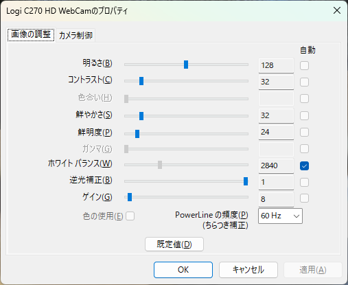

| 問題 | 改善 |
|---|---|
| OpenCV を入れても `import cv2` で DLL エラー | Windows のスマート アプリ コントロールが止めていたのでオフにした |
| 露出を手動にすると真っ暗(自動時の表示 -6 は実際の値ではなかった) | 露出は上限の 0 に固定。足りない明るさはライトで補う |
| ホワイトバランスをプログラムで手動にすると青が消える | 未解決。色の差の取り方で影響を小さくしている |

---

## 2. 白黒の差分では反応しなかった

最初は画像を白黒にしてから比べていました。ダーツを 5 本刺しても、diff はほぼ真っ黒です(白い線は時計の針やカーテンの揺れ)。

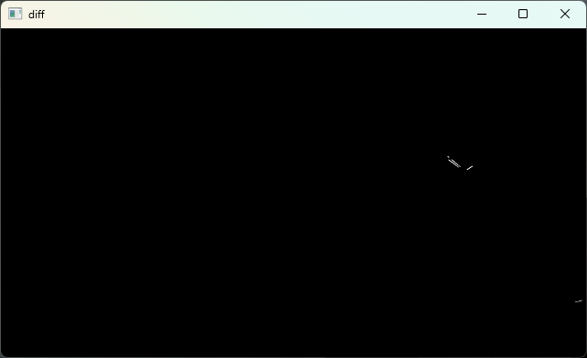

**原因**: 白黒にすると、黄色いフライトと白いマットの明るさがほぼ同じになってしまう。

**改善**: 色(青・緑・赤)ごとに差を取り、いちばん大きく変わった色の差を使うようにした。あわせて、的のまわりだけを見る範囲(ROI)を選ぶようにして、時計やカーテンを無視した。

| ダーツなし | ダーツあり |
|---|---|
| 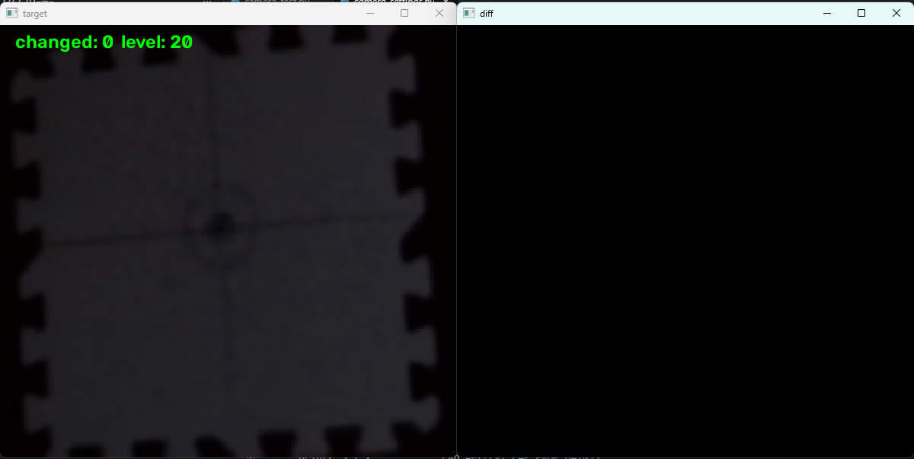 | 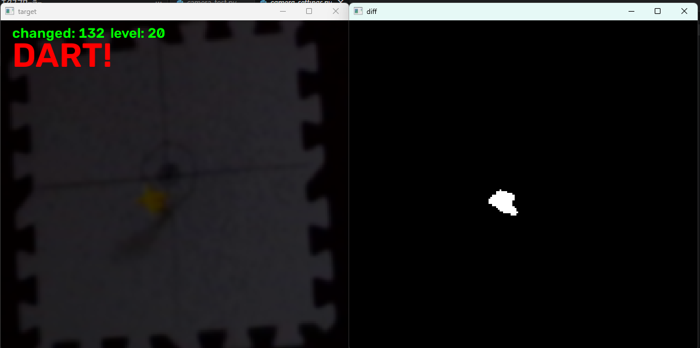 |

ダーツなしで変化 0、1本刺すと 132 になり、はっきり区別できるようになった。

---

## 3. 影の先を「先端」とまちがえた

先端の見つけ方は「白いかたまりの重心から、いちばん遠い点」。フライトは大きいので重心がそちらに寄り、反対側のとがった先が先端になる、という考えです。

しきい値を下げてバレルまで映るようにしたら、天井の照明でできた**長い影**も白くなり、影の先が「いちばん遠い点」になってしまいました。

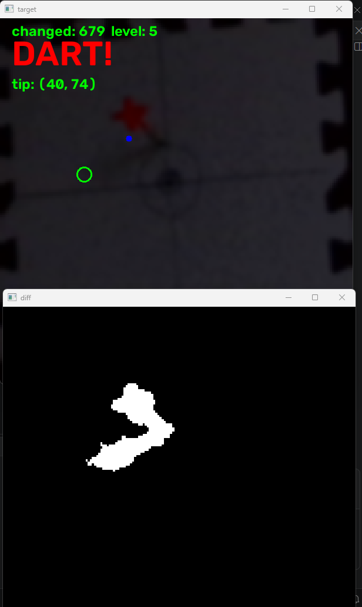

**改善**: 的のまわりに LED テープを貼った。いろいろな方向から光が当たるので、影が短く薄くなった。

| LED テープ | 影が短くなり先端が合う |
|---|---|
| 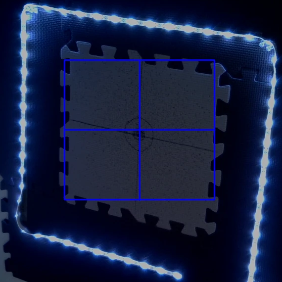 | 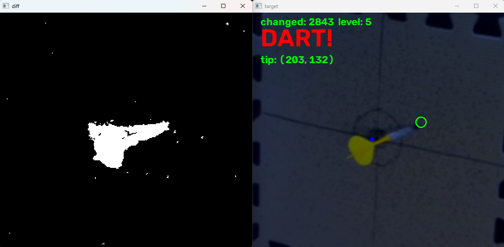 |

壁と平行に貼っただけなので明るさはあまり変わらないが、影を消す効果は大きかった。

---

## 4. 投げた衝撃でマットやダーツがずれる

ダーツが刺さった衝撃で、マットや前に刺さっていたダーツが少し動きます。すると、模様や輪郭が**細い線・小さな点**として白く出て、先端の位置がずれました。

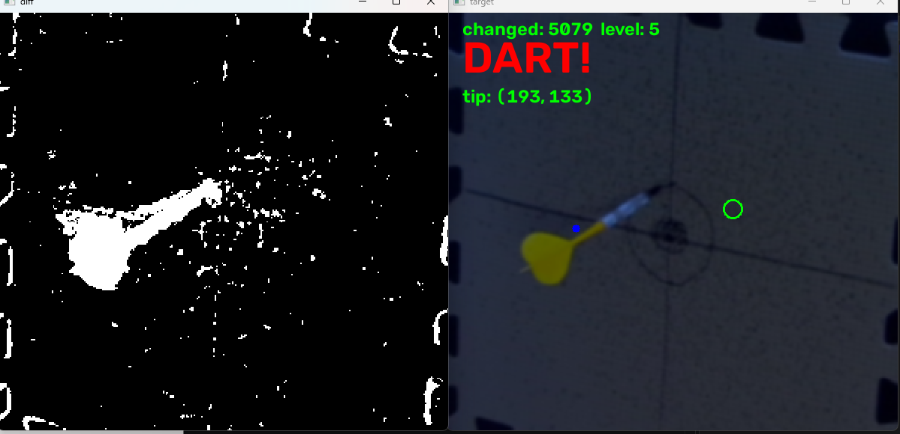

**改善**: 「オープニング」という処理を追加。白い部分をいったん細らせて細い線や点を消し、そのあと太らせて元の形に戻す。太いダーツは残り、細いノイズだけが消える。

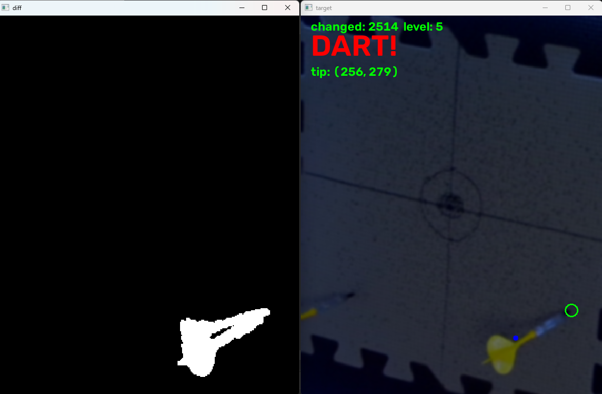

ダーツが密集しても、だいたい正しい先端を見つけられた(黄色いフライトが赤いダーツに重なっている例)。

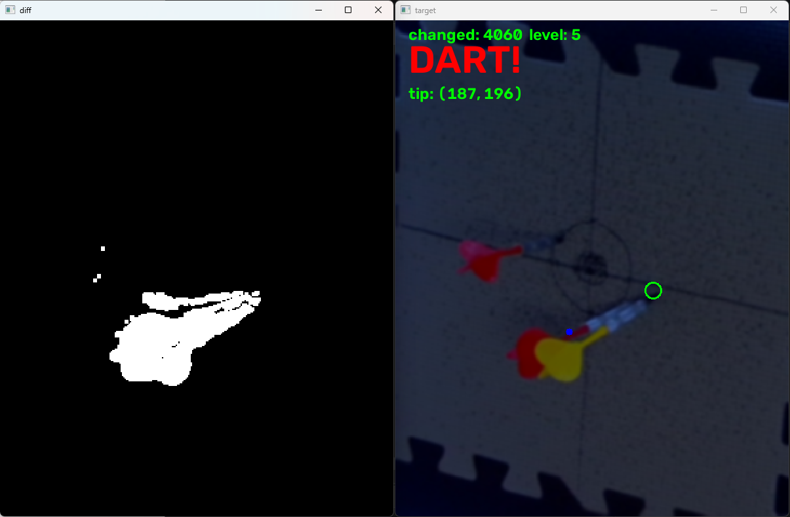

---

## 5. 真ん中の丸に入ったか判定する

カメラは斜めから見ているので、まん丸は少しつぶれた**だ円**に見えます。そこで、丸のふちを 5〜8 か所クリックし、その点にいちばん合うだ円を OpenCV(`fitEllipse`)に計算してもらいます。

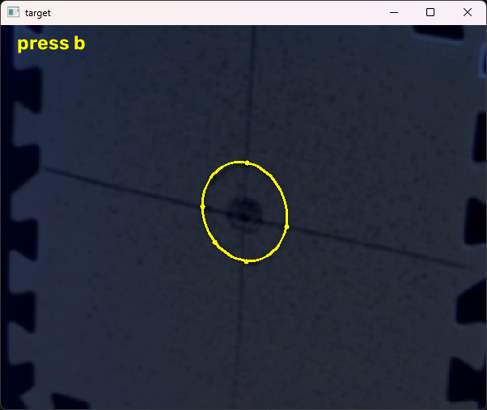

先端がだ円の中にあるかを `pointPolygonTest` で調べて、IN! / OUT を表示します。

| OUT | IN! |
|---|---|
| 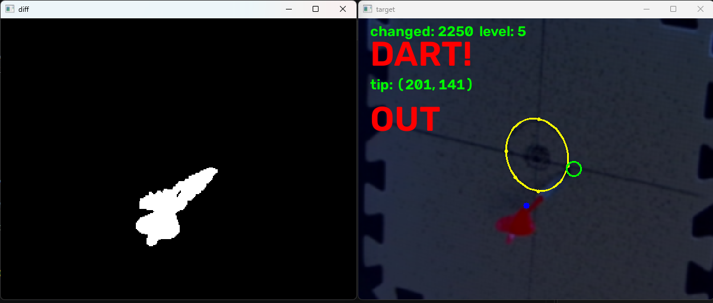 | 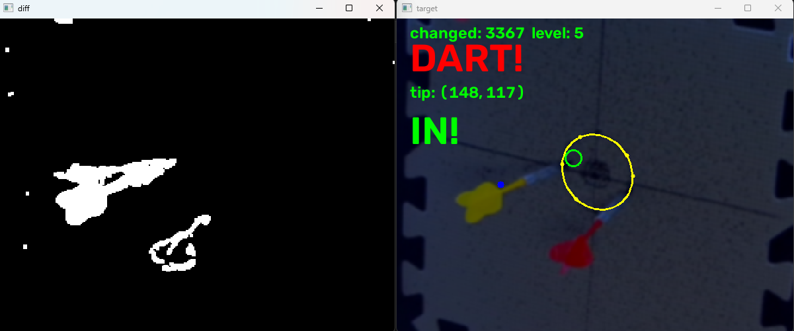 |

---

## 6. まだ残っている課題

**刺さらなかったのに DART! になる**

刺さらなかったとき、前のダーツが揺れた跡(輪の形)やノイズの合計で反応してしまった。

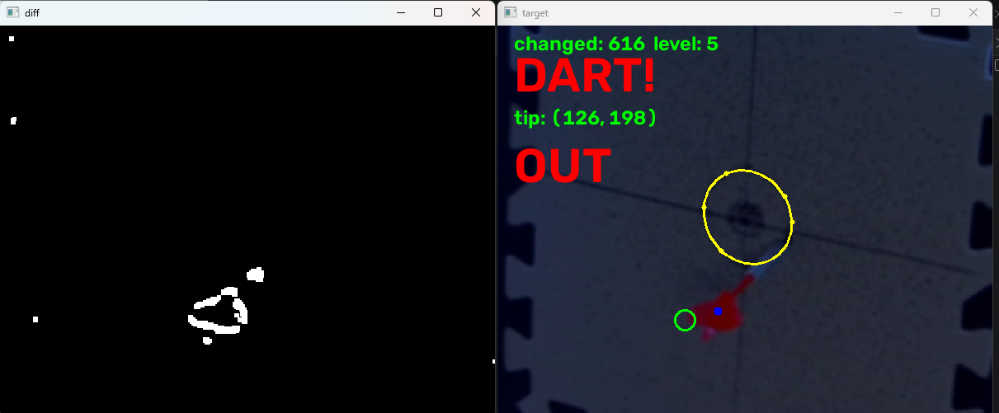

→ 合計ではなく「いちばん大きいかたまりの大きさ(biggest)」が 400 以上のときだけダーツとみなすように変更。実際の値での調整はまだ。

**ほかに**
- ダーツが密集したとき、前のダーツに隠れると先端が見えないかもしれない → 困ったらカメラを増やす
- ホワイトバランスの固定
- LED テープを壁から少し立てた枠の内側に貼ると、もっと影が減るかもしれない
